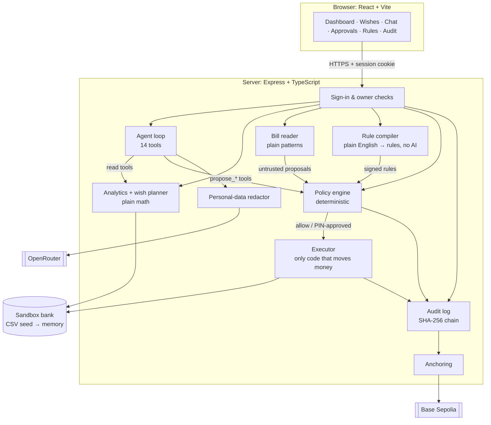
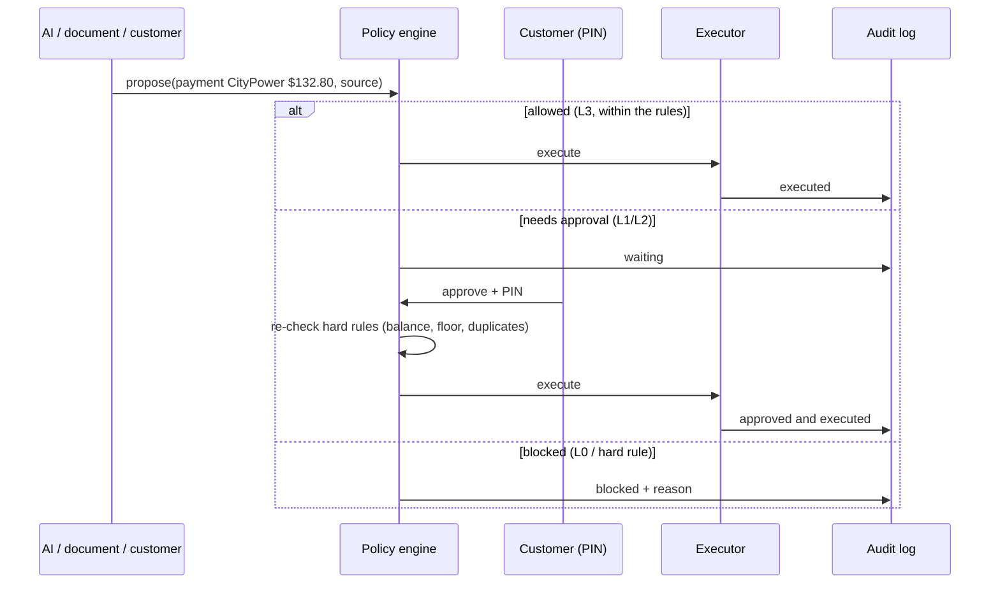
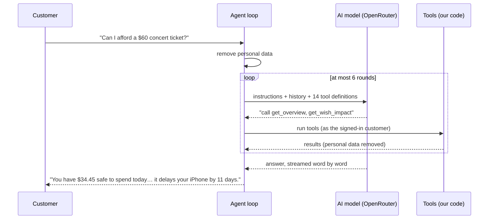

# MoneyWise: Technical Documentation

> **What:** an AI money assistant that can act inside a (simulated) bank account, within rules the customer signs.
> **Live:** https://moneywise-ffhs.onrender.com · **Code:** this repository · **Date:** Oct 19, 2026.
> **Companion documents:** [`SECURITY_SELF_ASSESSMENT.md`](SECURITY_SELF_ASSESSMENT.md) (every control and its proof), [`API_CONTRACT.md`](API_CONTRACT.md) (every endpoint), [`evidence/`](evidence) (attack runs against the live site).

---

## 1. Overview

Most finance apps only *show* you your money. MoneyWise also *acts*: on payday it pays the bills that are due, saves towards your wishes and offers to cancel subscriptions you don't use. An AI that can move money is only acceptable if a fooled AI still can't do damage, so the whole system is built around one rule:

> **The AI only proposes. Plain code decides. Only the customer's PIN approves.**

Three consequences shape the architecture:

1. **Every number is computed by code**, never by the AI: balances, forecasts, safe-to-spend, budgets, savings plans. The AI reads them through tools and explains them.
2. **Every money action goes through one deterministic policy engine**, whoever asks (the customer, the AI, a document), and only an *executor* behind it can move money.
3. **Everything is recorded** in a hash-chained audit log whose fingerprint is published on a public test blockchain.

| | |
|---|---|
| Backend | Express 5 + TypeScript, ~5,500 lines in 13 modules |
| Frontend | React 19 + Vite, ~3,300 lines |
| Shared | Zod schemas used by both (`packages/shared`), so the two can't drift apart |
| AI | Any OpenRouter model (live: `anthropic/claude-haiku-5.5`), 14 tools, streamed answers |
| Tests | 212 automated (29 red-team); 19 attacks run against the live site, all pass |
| Hosting | One Render web service (512 MB); test blockchain: Base Sepolia |

---

## 2. System architecture



### 2.1 Modules (`apps/api/src`)

| Module | Responsibility |
|---|---|
| `store/` | Loads and validates the seed CSVs into memory; the only door to the data |
| `analytics/` | Recurring payments, pay cycle, forecast, safe-to-spend, budget, bills, subscriptions |
| `wishes/` | Savings plans per wish, priorities, ETAs, "this purchase delays your iPhone by N days" |
| `policy/` | The engine (`engine.ts`), the rule compiler (`compile.ts`), the AI rules helper (`explain.ts`) |
| `actions/` | Propose → decide → execute; approvals with PIN; the executor; live events |
| `agent/` | The AI loop (`index.ts`), OpenRouter client (`llm.ts`), tools, redactor, payday routine |
| `documents/` | Bill upload: PDF text, fields, injection scan, untrusted proposals |
| `audit/`, `anchor/` | Hash-chained log; publishing and checking fingerprints on-chain |
| `auth/` | Passwords, PINs, lockouts, signed session cookies, owner checks |
| `http/` | Errors, security headers, Server-Sent Events |
| `routes/` | Thin Express routes: validate input (Zod) → call a module → JSON |

---

## 3. Flows

### 3.1 A money action, from proposal to audit



Every proposal becomes an `Action` with a status (`executed`, `pending_approval`, `denied`, `rejected`), the engine's reasons in plain English, and the wish it delays. A decided action can't be decided again (409). Changes are pushed to the browser over Server-Sent Events (the live activity timeline).

### 3.2 A chat message



The AI never sees a customer id: tools always run as the signed-in customer. At most 3 proposals per message; one chat at a time per customer; a 45-second timeout; a fallback model if the first one fails.

---

## 4. Data

### 4.1 Storage

The "bank" is ours: CSV files in `data/seed/` (customers, accounts, transactions, wishes, subscription usage) are validated with Zod at start-up and loaded into memory. Changes during a demo live in memory; an admin reset (or a restart) returns to a clean demo. This was a deliberate choice for a hackathon with synthetic data: deterministic demos, no database to secure or migrate. A real deployment would read from the bank's core systems or open-banking APIs and keep MoneyWise's own state (rules, actions, audit) in a database.

### 4.2 Conventions

- **Money is integer cents** everywhere (`13280` = $132.80): no floating-point errors in balances.
- **Dates are `YYYY-MM-DD` text**, and the demo runs on a **fixed "today" (Oct 12, 2026)** so every number in the demo is reproducible. The interface shows "Demo date: Oct 12, 2026"; audit times are real.
- **Shared schemas:** every request, response and stored object has a Zod schema in `packages/shared`, used by the API (validation) and the web app (parsing).

---

## 5. Core algorithms

All of these are plain, unit-tested functions. Examples use Maya, a student paid weekly.

### 5.1 Recurring payments ([`analytics/recurring.ts`](../apps/api/src/analytics/recurring.ts))

Everything else builds on finding what repeats.

1. Group transactions by account + merchant + direction (in/out).
2. Classify the gaps between dates: daily (1–2 days), weekly (6–8), biweekly (13–16), monthly (27–33). At least 3 occurrences, and at least 60% of the gaps must fit.
3. Skip choices (dining, shopping, groceries, fun) and amounts that vary more than 25%: those aren't bills.

Result, e.g.: *Greenview Student Housing, $750, monthly* · *Campus Cafe Payroll, weekly* · *FitZone $29.99 monthly*.

### 5.2 Pay cycle ([`analytics/payCycle.ts`](../apps/api/src/analytics/payCycle.ts))

The main income is the recurring income bringing at least 25% of the money (the most frequent wins a tie); unusual spikes over 2× the usual are ignored. It gives the cadence (Maya: weekly, Fridays), the next payday, and the **usual surplus per payday** (Maya: $47.06 left after all normal spending), which the wish planner uses.

### 5.3 Forecast and safe-to-spend ([`analytics/forecast.ts`](../apps/api/src/analytics/forecast.ts))

**Forecast:** walk the checking balance forward day by day for 30 days, adding predicted pay, rent, bills and card payments on their dates, plus average everyday spending. The dashboard chart shows it with the safety floor; the lowest point is highlighted (Maya: $387.56 on Oct 15, the day before payday).

**Safe to spend today** is a **per-day allowance for everyday spending**. Project the balance with commitments only, then for each day *d* of the next 30:

> allowance(*d*) = (planned balance on day *d* − floor) ÷ *d* · safe to spend = the smallest allowance

The tightest day decides. Maya: day 25 (Nov 5), ($1,061.37 − $200) ÷ 25 = **$34.45 a day**. That's why it's far below the $508.92 in her checking account: most of that money is already promised to rent and bills.

### 5.4 Budget ([`analytics/budget.ts`](../apps/api/src/analytics/budget.ts))

Each category's limit is the average spent in the last 3 full months, leaving out one-offs (e.g. a tuition bill), rounded up to $5. Insights compare spending with the month's pace (*"Dining is ahead of pace: $77.85 of $175 spent already"*).

### 5.5 Wish planner ([`wishes/planner.ts`](../apps/api/src/wishes/planner.ts))

1. **Needed per payday** = what's left ÷ paydays until the target date. iPhone: $1,050 ÷ 26 Fridays = **$40.39**.
2. **Priority:** wishes are planned in order; each gets what's left of the usual surplus after the ones above it. Maya: $47.06 − $40.39 = **$6.67** for her 2nd wish (Kyoto, which needs $26.00).
3. **Status** compares needed with available: up to 60% = on track, up to 100% = tight, more = not realistic.
4. **What it really gets** = the smaller of needed and available; the **ETA** is the payday when that pace reaches the target (iPhone: Apr 9, 2027, 3 days early; Kyoto: Jul 9, 2027, 201 days late).
5. **Wish impact:** a purchase delays the top active wish by amount ÷ its daily pace. A $60 ticket ÷ ($40.39 / 7 days) = **11 days**. Every payment card shows this.

### 5.6 Policy engine ([`policy/engine.ts`](../apps/api/src/policy/engine.ts))

Pure function: `evaluate(action, context) → { decision, tier, reasons }`.

1. **Hard blocks**, for everyone: kill switch (agent) → a document paying someone new → the same bill twice → the same cancel/dispute twice → transfer to the same account → not enough money → below the floor → over the agent's daily cap.
2. **The customer's own request** passes.
3. **The agent:** start from what a rule grants, apply every limit (over the per-payment cap, new payee, untrusted source → at least L2); **the strictest tier wins**.
4. L3 → allow · L2/L1 → approval · L0 → deny.

Payees are matched by exact name, so a look-alike ("C1tyPower") is a new payee. The full tier table is in the security self-assessment, section 3.

### 5.7 Rule compiler ([`policy/compile.ts`](../apps/api/src/policy/compile.ts))

Plain-English sentences → typed rules, with **no AI**: if the AI wrote the rules that limit the AI, a prompt injection could rewrite them.

| Sentence | Rule |
|---|---|
| "Never let my checking go below $200." | `balance_floor` checking $200 |
| "Ask me before any payment over $100 or to anyone new." | `amount_cap` $100 → L2 · `new_payee` → L2, 24 h |
| "Never move more than $500 a day." | `daily_cap` $500 |
| "Save up to $80 for my wishes every payday." | `wish_autosave` $80 → L3 |

Sentences it doesn't understand are reported, never guessed; risky rules are flagged. An optional AI helper explains unclear sentences and suggests rewrites, and **every rewrite goes back through the compiler**. Signing needs the PIN, and the server recompiles the text itself.

### 5.8 Agent loop and tools ([`agent/`](../apps/api/src/agent))

**9 read tools:** overview, bills, subscriptions, budget, forecast, rules, wishes, recent transactions, wish impact. **5 propose tools:** payment, transfer, wish contribution, cancel subscription, dispute. Each tool's arguments are validated with Zod; a propose tool creates an `Action` with `source: "agent"` hard-coded and returns the engine's decision in its own words, which the AI then reports. There is no tool to approve, sign rules or change tiers.

The OpenRouter client streams the answer, reassembles tool calls from the stream, falls back to a second model, and asks providers not to keep data (`data_collection: "deny"`).

### 5.9 Payday routine ([`agent/payday.ts`](../apps/api/src/agent/payday.ts))

Runs once per demo (Run payday), as the agent, so every step goes through the engine: (1) pay the bills due before the next payday, (2) auto-save for wishes at their affordable pace, (3) offer to cancel subscriptions unused for 30+ days, (4) offer to dispute charges that look like duplicates. Maya's payday: $35 bill paid and $40.39 + $6.67 saved automatically; cancelling the gym waits for her PIN.

### 5.10 Bill reader ([`documents/`](../apps/api/src/documents))

PDF → text (unpdf, Mozilla's PDF engine) → payee, amount and due date with labelled-line patterns → scan for text aimed at an AI ("ignore your rules", "pre-approved", "bank details changed") → the bill becomes an **untrusted** proposal (always needs the PIN, can never add a payee) → every *other* payment the document asks for is run through the engine as if the AI had obeyed, to show it's blocked. Unreadable bills are refused, never guessed.

### 5.11 Audit chain and anchoring ([`audit/`](../apps/api/src/audit), [`anchor/`](../apps/api/src/anchor))

Each entry: `hash = SHA-256(previous hash + the entry's content in a stable JSON form)`. Editing or deleting any entry changes every hash after it; `GET /api/audit/verify` finds the first broken entry. Every 15 minutes (if there's anything new), the latest `seq` and hash are published as the text `moneywise-audit:v1:<seq>:<hash>` in a zero-value transaction on Base Sepolia, from a dedicated test wallet to itself. Anyone can read the transaction back and compare it with the log (`GET /api/anchors/:txHash/check` does this against the chain itself).

---

## 6. Security design

Summary; every control with its proof is in [`SECURITY_SELF_ASSESSMENT.md`](SECURITY_SELF_ASSESSMENT.md).

| Layer | Control |
|---|---|
| Who are you? | scrypt-hashed passwords; HMAC-signed, HttpOnly, SameSite, Secure session cookie (8 h) |
| What may you touch? | Owner check on every customer route and every object id (403) |
| Is it really you, now? | PIN for approvals, signing rules, turning the agent on; growing PIN lockout |
| What may the AI do? | Propose only; 14 tools, none that approve; limits per message |
| What may a document do? | Nothing on its own: untrusted, no new payees, always the PIN |
| What may move money? | Only the executor, after the engine or a PIN approval; re-check at approval |
| What leaves the server? | Personal data removed before the AI; no-training providers |
| Can history be changed? | Hash chain + on-chain fingerprint |
| Browser | Strict Content-Security-Policy, HSTS, no framing, no referrer, `X-Powered-By` removed |

---

## 7. Frontend (`apps/web`)

React 19 + Vite, written by our frontend developer against the API contract.

- **One API client** (`lib/api.ts`): every response is parsed with the shared Zod schemas, so a contract change shows up as an error, not a silent wrong number. A 401 anywhere returns to the sign-in screen.
- **Streaming:** chat answers and the activity timeline use Server-Sent Events, so text appears word by word and approvals update live.
- **Screens:** overview (safe-to-spend, cash, 30-day forecast chart, budget, wishes, bills), wishes (list, plan, savings chart), chat, approvals with the PIN, activity, transactions, subscriptions, bills with upload, rules editor, audit log with on-chain anchors.
- **Charts** are hand-made SVG (no chart library): hover, tap or arrow keys show each day, with the safety floor, paydays and bills marked.
- Served by the same Express server from `apps/web/dist`, so there's one origin, one cookie and a strict Content-Security-Policy.

---

## 8. Deployment

```
GitHub (main) → Render (one web service, free plan, 512 MB)
  build:  npm ci --include=dev && npm run build     (builds the web app into apps/web/dist)
  start:  node --max-old-space-size=320 --import tsx apps/api/src/index.ts
```

- **One process** serves the API and the web app (an npm script chain used ~300 MB; a single capped Node process ~135 MB, which fixed an out-of-memory crash on PDF uploads).
- **Configuration** only through environment variables: `SESSION_SECRET`, `ADMIN_KEY`, `OPENROUTER_API_KEY`, `LLM_MODEL`, `LLM_FALLBACK_MODEL`, `ANCHOR_PRIVATE_KEY`; development switches (`AUTH_DISABLED`, `LLM_ALLOW_PROVIDER_TRAINING`) are off on the live site.
- A keep-alive ping stops the free plan from sleeping; the in-memory demo resets on restart by design.

---

## 9. Testing and evidence

| Level | What | Where |
|---|---|---|
| Unit | Every algorithm in section 5 with real numbers (e.g. $34.45, $40.39, 11 days) | `apps/api/test/*.test.ts` |
| API | Every endpoint through HTTP (supertest), signed in as the right and the wrong customer | same |
| Red team | 29 attacks that must fail (injection, look-alikes, splitting, PIN guessing, duplicates…) | tests named "red team" |
| End to end | The demo story + 19 attacks against a running server with the real AI; PASS/FAIL judged on what the server did, never on the AI's wording | `npm run evidence` → `docs/evidence/` |

`npm test` runs 212 tests in about 10 seconds. The last full evidence run was against the live site on Oct 19: all 19 attacks pass.

---

## 10. Key decisions

| Decision | Why | Rejected |
|---|---|---|
| Policy engine in plain code | Deterministic, testable, explainable; can't be talked into anything | Letting the AI judge its own actions |
| Rule compiler without AI | The rules that limit the AI must not be written by the AI | AI-generated policy JSON |
| Bill reader without AI | Hidden text in a PDF must never become an instruction | Sending the PDF to the AI |
| Numbers by code, words by AI | The AI can't invent a balance | AI-calculated totals |
| OpenRouter, model in an environment variable | Swap models without code changes; privacy routing | One vendor's SDK |
| CSV → memory, fixed demo date | Reproducible demos, nothing to secure or migrate | A database for synthetic data |
| Shared Zod schemas | Frontend and backend can't drift | Hand-written types twice |
| Stateless signed cookies | Sign-ins survive restarts with an in-memory store | Server sessions (but see risks) |
| Hash chain + testnet anchor | Tamper evidence anyone can check, without real money | Mainnet; no anchoring |

---

## 11. Limits and path to production

| Today (hackathon) | In production |
|---|---|
| Synthetic customers in memory | The bank's core systems / open-banking APIs; MoneyWise state in an encrypted database |
| Public demo accounts and PINs | The bank's own sign-in with MFA; server-side sessions that can be revoked |
| Bills in common formats via patterns | More formats over time, structured e-bills; an "unusual amount" warning |
| Test blockchain | Mainnet or a bank-run ledger |
| One server process | Several instances with shared lockout and session stores |

The known-risk list is in the security self-assessment, section 9.
